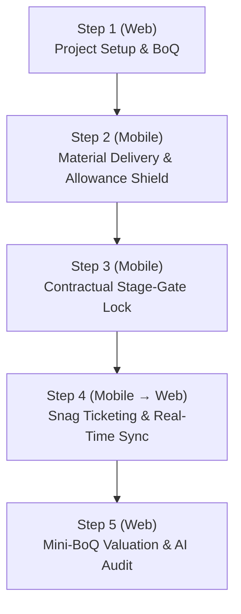

# Center Estates Construction & Mobile Field App — Presentation Cheat Sheet

**Live Demo Project**: Karam Apartments — Lang'ata (`PRJ-KRM-01` / ID: `ce-construction-karam-001`)  
**Backend API**: `https://api.centerestates.com/api/v1/construction`  
**Web ERP URL**: `https://centerestates.com` (or local port `3000`)  
**Live Mobile Expo Go URL**: `exp://vpofj68-anonymous-8081.exp.direct`  
**Cloudflare Tunnel**: `https://further-camcorders-recruitment-subscriber.trycloudflare.com`  

---

## 1. Executive Pitch (30-Second Hook)

> *"Construction projects in Kenya typically lose 15% to 25% of their budget to three blind spots: unauthorized material overages at the site gate, unverified contractor progress claims, and phantom deliveries.  
> **Center Estates** eliminates these blind spots by putting a cryptographic, offline-first mobile app in the Clerk of Works' hands that is directly synchronized with the developer's Bill of Quantities (BoQ) and CPM Work Plan. Every delivery is checked against budget limits, and no milestone payout can happen until prerequisite stage-gates are 100% verified."*

---

## 2. 5-Step Live Demonstration Script



### Step 1: Office Setup & Contractual Baseline (Web ERP — 1 min)
1. Log into **Center Estates Web ERP**.
2. Select **Karam Apartments — Lang'ata** from the Project switcher.
3. Open **Work Plan**: Show the CPM Gantt chart with tasks (`WP-001 Substructure Excavation`, `WP-002 Raft Foundation Concreting`).
4. Open **BoQ**: Show the line items with approved budget allowances (e.g., *Ordinary Portland Cement — 1,200 Bags*).
* **Narrative**: *"Before any concrete is poured, the Quantity Surveyor and Project Manager establish the baseline Work Plan and BoQ allowances in the office."*

---

### Step 2: Site Gate Material Delivery (Mobile App — 2 mins)
1. Open the **Mobile App** on your device or screen mirror.
2. Navigate to **Site Diary** $\to$ tap **Material Deliveries** $\to$ tap **Record Material Delivery**.
3. Tap **Select Bill of Quantities (BoQ) Item**:
   * Search for *"Cement"* and pick the line item.
   * Notice that the **Material Name**, **Unit (Bags)**, and **Planned Allowance (1,200 Bags)** auto-populate immediately.
4. Tap the **Supplier Chip**: select **Bamburi** (or *Apex Steel*, *Devki*).
5. Enter **Quantity Delivered**: `50`.
6. Enter **Delivery Note / Invoice No.**: `DN-BAM-9081`.
7. Link to Work Plan Task: Select `WP-001 Substructure Excavation`.
8. Point out the **Planned Allowance Shield**: Show the green badge showing remaining budget margin.
* **Narrative**: *"Clerks no longer write delivery notes on paper receipts that get lost in site trailers. Every bag of cement is matched to a specific BoQ item and work plan activity at the site gate."*

---

### Step 3: Contractual Milestone Stage-Gates (Mobile App — 2 mins) ★ High-Impact
1. From the Mobile Hub, tap **Milestones**.
2. Tap on the downstream milestone: **Superstructure Frame**.
3. Highlight the prominent alert banner:  
   `🔒 Contractual Stage-Gate Locked: Preceding milestone(s) must reach 100% completion before work on this milestone can advance.`  
   `• Substructure & Raft Foundation — currently 50% (incomplete)`
4. Attempt to move the slider or tap **Sign & submit**:
   * The button shows `🔒 Stage-gate locked`.
   * Tapping it triggers the native security alert dialog blocking submission.
* **Narrative**: *"This is our Contractual Stage-Gate Engine. In traditional setups, contractors claim 30% on superstructure while the foundation is still half-finished. Our system makes that mathematically impossible — both on the mobile phone and at the backend API."*

---

### Step 4: Snag / Defect Ticketing & Live Sync (Mobile $\to$ Web — 1.5 mins)
1. On Mobile, navigate to **Tickets & Snags**.
2. Tap **+ New Ticket**.
3. Title: *"Rebar spacing discrepancy in Beam B4"*.
4. Category: **Quality Defect** | Priority: **High**.
5. Description: *"Main reinforcement bars spaced at 250mm instead of approved structural 150mm specification."*
6. Tap **Create Ticket**.
7. Now switch immediately to the **Web ERP** monitor screen:
   * Click **Tickets** on the web navigation.
   * Show the ticket instantly appearing on the Kanban board with the High Priority tag.
* **Narrative**: *"Field engineers don't wait for weekly meetings to flag defects. Defects logged on site sync instantly to the consultant's dashboard for rectification."*

---

### Step 5: Mini-BoQ Interim Valuation & AI Progress Audit (Web ERP — 1.5 mins)
1. On Web, navigate back to **Milestones**.
2. Click the **Mini-BoQ** action button on an active milestone.
3. Show the **Mini-BoQ Valuation breakdown**:
   * Total line items, certified value in KES, and variance against actual progress.
4. Click **Run AI Progress & Variance Audit**:
   * Point out the AI summary analyzing schedule slip, material consumption variance, and projected completion date.
* **Narrative**: *"When the contractor requests an interim payment certificate (IPC), the QS doesn't guess. The system compiles every verified daily log, delivery note, and milestone evidence into an automated audit report."*

---

## 3. Defense Guide: Handling Stakeholder Questions

| Question | Winning Answer |
| :--- | :--- |
| **"What happens when the Clerk is in a basement with zero 4G/Wi-Fi?"** | *"The app is 100% offline-first. All data and photos are stored locally in an encrypted SQLite database on the device. When the Clerk walks into network coverage, our delta-sync engine automatically negotiates conflict-free sync with the cloud."* |
| **"How do you stop a Clerk from taking photos of yesterday's work or a different site?"** | *"Every photo captured through the app's camera is stamped with GPS coordinates, hardware EXIF metadata, and an immutable SHA-256 hash. Our server automatically geofences each photo against the project boundary and flags off-site photos as fraud risks."* |
| **"Can the contractor modify or delete evidence after submitting?"** | *"No. Submitted evidence is cryptographically sealed and append-only. Any attempt to modify a record invalidates the digital signature seal."* |
| **"Is this separate from our main property ERP?"** | *"No. It is fully integrated into Center Estates. Once construction reaches Practical Completion, units automatically roll over into the Sales and Facilities modules with full handover history."* |

---

## 4. How to Generate the Standalone APK (EAS)

If you have an active Expo account and wish to trigger the standalone APK build on your machine:

```bash
cd /root/Dev/Center_Estates/apps/mobile

# 1. Log in to your Expo account
npx eas-cli login

# 2. Build the Android APK (takes ~10 mins in Expo Cloud)
npx eas-cli build --platform android --profile preview
```
* Once completed, EAS prints a **direct download URL and QR code** that installs directly onto any Android phone.
