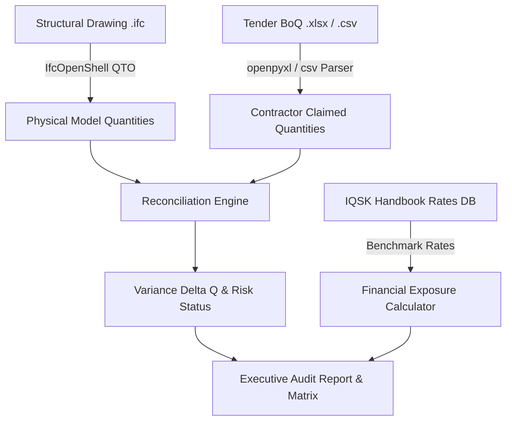

# Walkthrough: IQSK Cost Handbook Extraction & BIM Drawing vs. BoQ Quantity Verification

We have extracted all data from the **166-page scanned IQSK Construction Costs Handbook (2023–2024 Edition)**, structured and persisted the rates into the database and JSON/CSV datasets, and built the automated **BIM Structural Drawing vs. Tender Bill of Quantities (BoQ) Verification Engine** with `IfcOpenShell`.

---

## 1. IQSK Cost Handbook (2023–2024) Extraction & Data Storage

### Document Details
- **Source File**: [`937126954-IQSK-Cost-Handbook-2023-2024.pdf`](file:///root/Dev/Center_Estates/937126954-IQSK-Cost-Handbook-2023-2024.pdf)
- **Publication**: Published in collaboration with the **State Department for Public Works**, **Kenya National Bureau of Statistics (KNBS)**, and the **Institute of Quantity Surveyors of Kenya (IQSK)**.
- **Coverage**: 166 pages (Part A: Contractor's All-In Unit Rates, Part B: Plant & Equipment Hire, Part C: Approximate Estimating Rates per $m^2$).

### Extraction Pipeline & Output Datasets
We constructed a parallel extraction pipeline ([`apps/backend/scripts/extract_iqsk_handbook.py`](file:///root/Dev/Center_Estates/apps/backend/scripts/extract_iqsk_handbook.py)) using `pdftoppm` + `tesseract` with optimized Page Segmentation (PSM 6) and multi-column regex parsers:
- **Total Line Items Extracted**: **1,550 unique construction trade rates**
- **JSON Dataset**: [`apps/backend/data/iqsk_rates_2023_2024.json`](file:///root/Dev/Center_Estates/apps/backend/data/iqsk_rates_2023_2024.json) (607 KB)
- **CSV Dataset**: [`apps/backend/data/iqsk_rates_2023_2024.csv`](file:///root/Dev/Center_Estates/apps/backend/data/iqsk_rates_2023_2024.csv) (214 KB, 1,551 rows)

### Extracted Trades Breakdown
| Trade Code | Trade Description | Items Extracted | Key Measurement Units |
| :--- | :--- | :--- | :--- |
| `CONCRETE` | Concrete (In-Situ Foundations, Columns, Beams, Slabs) | 31 items | `CM` ($m^3$), `SM` ($m^2$) |
| `REINFORCEMENT` | High Tensile Ribbed Bars (T8, T10, T12, T16, T20, T25, T32) & BRC Mesh | 27 items | `KG`, `TON` |
| `FORMWORK` | Sawn Timber & Coffer Formwork to Slabs, Beams, Columns | 17 items | `SM` ($m^2$), `LM` ($m$) |
| `WALLING` | Natural Machine-Dressed Stone (Ndarugu, Ruiru, Njiru) & Concrete Blocks | 32 items | `SM` ($m^2$), `LM` ($m$) |
| `EARTHWORKS` | Excavations, Rock Classes I-III, Hardcore Filling, Murram, Termite Treatment | 33 items | `CM` ($m^3$), `SM` ($m^2$) |
| `ROOFING` | Concrete & Clay Tiles, Box Profile Sheets, Versatile, Prepainted GI | 119 items | `SM` ($m^2$), `LM` ($m$) |
| `FINISHES` | Plaster, Screed, Porcelain, Ceramic, Granite, Terrazzo, PVC Ceilings | 151 items | `SM` ($m^2$), `LM` ($m$) |
| `STRUCTURAL_STEEL` | Hot Rolled SHS, RHS, CHS, Z-Purlins, RSJ, Universal Beams | 78 items | `KG`, `LM`, `NO` |
| `PLUMBING_DRAINAGE` | PPR, PVC, HDPE Pipes, Sanitary Ware, Manholes, Gullies | 290 items | `LM`, `NO` |
| `ELECTRICAL` | Cables (1.5mm–25mm), Conduits, Distribution Boards, Sockets, Lights | 148 items | `LM`, `NO` |
| `FIRE_FIGHTING` | Fire Extinguishers (Water, Foam, Powder, CO2), Smoke Detectors | 64 items | `NO` |
| `EXTERNAL_WORKS` | Precast Paving Slabs, Kerbs, Storm Channels, Roadworks | 95 items | `SM`, `LM`, `NO` |
| `CARPENTRY_JOINERY` | Flush & Panelled Timber Doors, Frames, Celotex, MDF, Gypsum | 76 items | `SM`, `NO`, `LM` |
| `METALWORK` | Aluminium Windows & Doors, Casements, Grilles, Roller Shutters | 71 items | `SM`, `NO` |
| `IRONMONGERY` | Mortice Locks, Hinges, Door Handles, Panic Bolts, Closers | 86 items | `NO`, `PAIR` |
| `PAINTING` | Emulsion, Gloss, Bituminous, Undercoats, Varnishes | 58 items | `SM` ($m^2$) |
| `WATERPROOFING` | 3-ply Bituminous DPC, Polythene Sheets, Basement Tanking | 28 items | `SM`, `LM` |
| `RAINWATER` | Prepainted & Plastic Gutters, Downpipes, Running Outlets | 68 items | `LM`, `NO` |
| `GLAZING` | Clear, Obscure, Georgian Wired, Toughened, Laminated Glass | 37 items | `SM` ($m^2$) |
| `DEMOLITIONS` | Site Clearance, Tree Felling, Demolition of Structures | 19 items | `SM`, `NO` |
| `PLANT_EQUIPMENT` | Heavy Plant Hire Rates (Tippers, Low Loaders, Excavators) | 9 items | `DAY`, `HR`, `TON` |
| `APPROXIMATE_ESTIMATING` | Building Cost per $m^2$ Benchmarks (Commercial, Residential) | 13 items | `SM` ($m^2$) |

### Database Persistence (`IQSKCostRate`)
- **Django Model**: [`construction.models.IQSKCostRate`](file:///root/Dev/Center_Estates/apps/backend/construction/models.py)
- **Migration**: [`0006_iqskcostrate.py`](file:///root/Dev/Center_Estates/apps/backend/construction/migrations/0006_iqskcostrate.py) applied cleanly.
- **Fields**:
  - `trade` (TextChoices enum across all 22 construction trades)
  - `subcategory`, `item_code` (e.g. `CONC-0001`, `REIN-0012`, `WALL-0005`)
  - `description`, `unit` (`SM`, `CM`, `LM`, `KG`, `TON`, `NO`)
  - `rate_nairobi` (Nairobi benchmark rate in KES)
  - `rate_coastal` (Coast / Mombasa rate in KES)
  - `rate_western` (Western / Rift rate in KES)
  - `rate_kes` (Standard national baseline rate)
  - `source_page` & `handbook_edition` (`2023-2024`)
- **Database Status**: **1,550 rows seeded directly in the database** and immediately queryable via ORM and REST API.

---

## 2. Automated Drawing vs. BoQ Verification Engine (`IfcOpenShell`)

### Core Verification Service ([`bim_verifier.py`](file:///root/Dev/Center_Estates/apps/backend/construction/services/bim_verifier.py))
The `BimBoqVerifier` engine performs automated 3-way reconciliation:

1. **IFC Structural Geometry Ingestion**:
   - `IfcFooting`: Net/Gross volume ($m^3$) and perimeter side formwork ($m^2$).
   - `IfcColumn`: Concrete volume ($m^3$) and 4-sided formwork contact area ($m^2$).
   - `IfcBeam`: Volume ($m^3$) and 3-sided formwork contact area ($m^2$).
   - `IfcSlab`: Suspended slab volume ($m^3$) and soffit formwork area ($m^2$).
   - `IfcWall`: Net vertical wall surface area ($m^2$) and volume ($m^3$).
   - `IfcReinforcingBar`: Explicit bar extraction or Kenyan/BS 8110 element density schedules ($kg$ rebar per $m^3$ concrete) broken down by bar sizes ($T8, T10, T12, T16, T20$).
2. **BoQ Ingestion**:
   - Parses Excel (`.xlsx`) or CSV spreadsheets, identifying description, unit, quantity, and unit rate columns automatically.
3. **Discrepancy & Omission Detection**:
   - Computes $\Delta Q = Q_{\text{BoQ}} - Q_{\text{Model}}$ and variance percentage.
   - Classifies risk:
     - `MATCHED`: Variance within $\le \pm 2\%$.
     - `TOLERABLE_VARIANCE`: Variance between $2\% - 10\%$ (acceptable laps and cutting wastage).
     - `CRITICAL_DISCREPANCY`: Variance $> \pm 10\%$ (overmeasured or underextracted).
     - `OMISSION`: Element modeled in drawings ($Q_{\text{Model}} > 0$) but omitted from BoQ ($Q_{\text{BoQ}} == 0$).
     - `PHANTOM_ITEM`: Item claimed in BoQ but absent from drawing model.
4. **IQSK Financial Exposure Benchmarking**:
   - Queries `IQSKCostRate` to match the statutory national benchmark rate.
   - Compares Tender Amount ($Q_{\text{BoQ}} \times \text{Rate}_{\text{Tender}}$) vs. IQSK Benchmark ($Q_{\text{Model}} \times \text{Rate}_{\text{IQSK}}$).
   - Computes net financial exposure (cost savings or contractor overmeasure risk).

---

## 3. Backend REST API Endpoints

- **`POST /api/v1/construction/bim/verify-quantities/`**:
  - Multipart upload of `ifc_file` (.ifc) and optional `boq_file` (.xlsx / .csv).
  - Returns executive summary KPIs, physical model quantities take-off, and the itemized audit matrix.
- **`GET /api/v1/construction/iqsk-rates/`**:
  - Search and filter handbook rates with `trade`, `unit`, `search` query, and pagination (`limit`, `offset`).
- **`GET /api/v1/construction/iqsk-rates/summary/`**:
  - Handbook metadata, publisher attribution, total rates count (1,550), and counts per trade.

---

## 4. Web Frontend: Verification Hub & Handbook Browser

### A. BIM & BoQ Verification Hub ([`BimVerificationHub.tsx`](file:///root/Dev/Center_Estates/apps/web/src/components/monitoring/pages/BimVerificationHub.tsx))
- **File Upload Section**: Drag-and-drop structural drawing (`.ifc`) and Tender BoQ (`.xlsx`/`.csv`), plus a **"Load Live Demo Model"** button for instant testing.
- **KPI Summary Cards**:
  - Overall Match Rate %
  - Critical Discrepancies Count
  - Omissions Count
  - Net Financial Exposure in KES
- **Physical Quantities Take-off Card**: Concrete volume ($m^3$), Formwork area ($m^2$), Reinforcement tonnage ($kg$/T), and Walling area ($m^2$).
- **Interactive Audit Matrix Table**: Filter by trade and risk severity, search filter, and side-by-side comparison of Model Qty vs. BoQ Qty vs. IQSK Benchmark Rate.

### B. IQSK Rates Handbook Browser ([`IQSKRatesHandbook.tsx`](file:///root/Dev/Center_Estates/apps/web/src/components/monitoring/pages/IQSKRatesHandbook.tsx))
- Full-featured browser across all 1,550 extracted rates.
- Displays regional columns: **Nairobi (KES)**, **Coastal (KES)**, **Western (KES)**, and original handbook page number.
- Trade filter selector covering all 22 construction trades.

### C. Navigation & Direct Routes
- Accessible directly in **Construction Monitoring** $\rightarrow$ **DOCUMENTS & DIGITAL**:
  - **BIM & BoQ Verification Hub** (`📐`)
  - **IQSK Cost Handbook** (`📖`)
- Direct Next.js page route at [`/construction/verification`](file:///root/Dev/Center_Estates/apps/web/src/app/construction/verification/page.tsx).

---

## 5. Verification & Test Results

1. **Handbook Data Extraction**:
   - `extract_iqsk_handbook.py` executed across 139 rate pages (pages 26 to 164).
   - Produced 1,550 structured rate items in `iqsk_rates_2023_2024.json` and `.csv`.
   - Seeded 1,550 rows into the `IQSKCostRate` table in SQLite.
2. **API Endpoint Verification**:
   - `IQSKRateSummaryView` returned HTTP 200 with 1,550 total rates across 22 trades.
   - `IQSKRateListView` returned HTTP 200 with filtered items (e.g., Concrete Class 25/20 @ KES 15,800/m³).
3. **BimBoqVerifier Unit Tests** ([`tests_bim_verifier.py`](file:///root/Dev/Center_Estates/apps/backend/construction/tests_bim_verifier.py)):
   - Verified IFC model generation and structural element extraction (`IfcFooting`, `IfcColumn`, `IfcBeam`, `IfcSlab`, `IfcWall`).
   - Verified reconciliation logic with exact match, over-measurement (+35%), tolerable variance (+5%), and drawing omission vectors.
   - Verified financial exposure calculation against IQSK benchmark rates.
